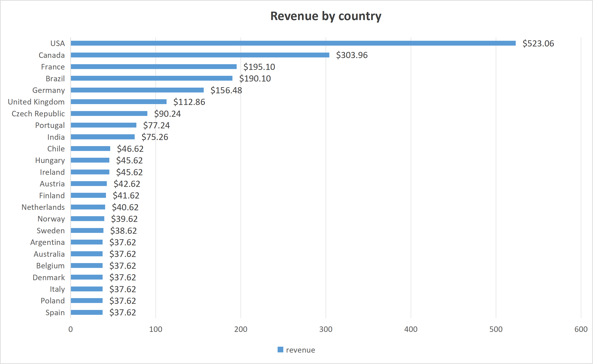
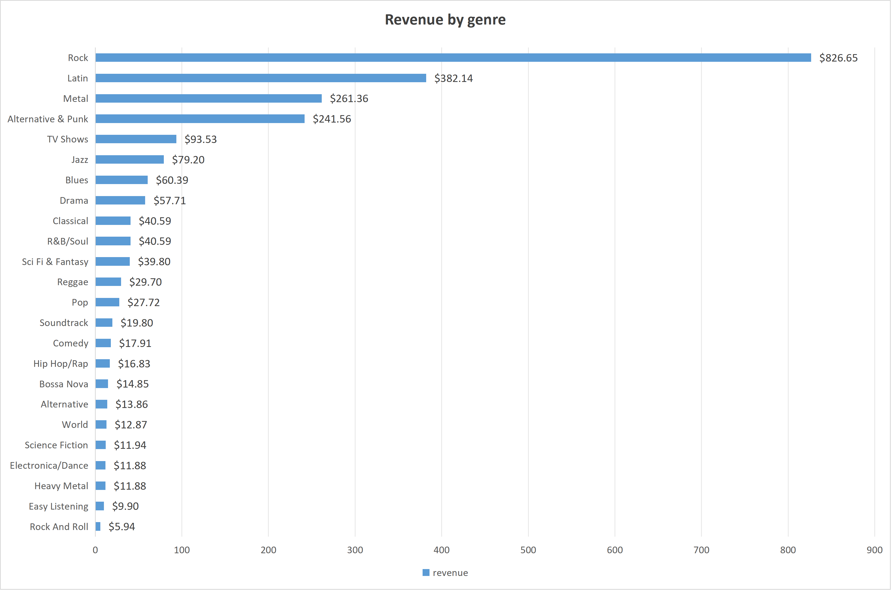
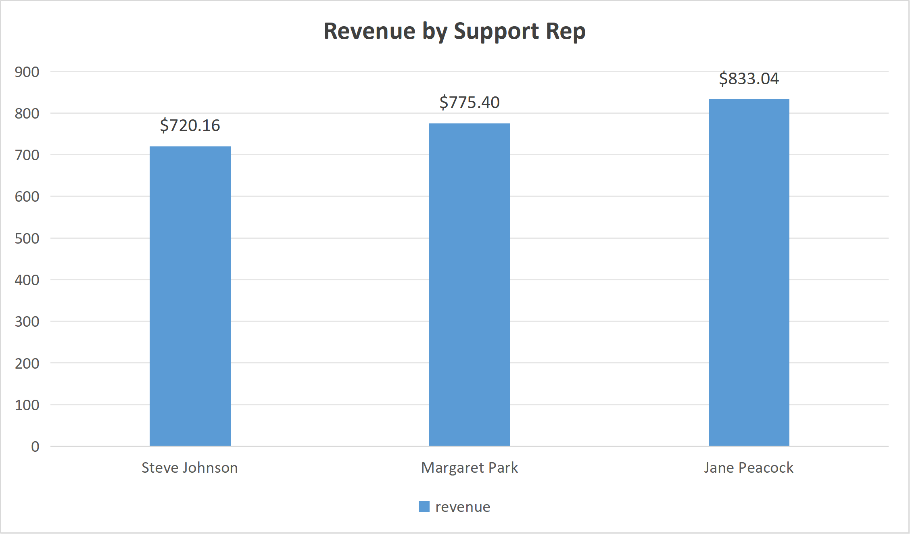

# Chinook 数字音乐商店销售分析

用 SQL 回答三个销售问题：收入来自哪些国家、哪些音乐体裁，以及三个销售员之间的业绩差异到底来自哪里。查询结果导出 CSV 后用 Excel 画图。

- **数据**：Luis Rocha 的 [Chinook Database](https://github.com/lerocha/chinook-database) v1.4.5，SQLite 版。这是教学用的示例库，客户、员工和订单为构造数据，曲目信息来自真实 iTunes 资料库。
- **区间**：2021-01-01 至 2025-12-22，共 412 张发票、59 名客户、25 个国家、2,240 行发票明细，总销售额 **$2,328.60**。
- **工具**：DB Browser for SQLite（建库与执行 SQL）、Excel（图表）。

## 结论摘要

1. 收入高度集中在少数国家：USA 与 Canada 两国贡献 **$827.02（35.5%）**，前五国合计 **$1,368.70（58.8%）**。
2. 体裁集中度更高：Rock 一个体裁 **$826.65（35.5%）**，前四个体裁合计 **$1,711.71（73.5%）**。
3. 三个销售支持专员的业绩差异主要来自**客户数量**，不是人均产出：Jane Peacock 收入最高（$833.04），但客均收入最低（$39.67）；Steve Johnson 客户最少（18 人）却客均最高（$40.01），三者客均收入只差 **$1.24（3.2%）**。

## 1. 业务问题

一家数字音乐商店想知道钱从哪来、往哪投，具体拆成三个可查询的问题：

1. 各国家的销售额和发票数是多少？收入是否集中？
2. 各音乐体裁的销售额和销量是多少？体裁之间的差异来自销量还是单价？
3. 三位销售支持专员（Support Rep）负责的客户贡献了多少收入？业绩差异来自客户数量还是单个客户的消费能力？

## 2. 数据说明

| 表 | 用途 | 用到的字段 |
| --- | --- | --- |
| `Invoice` | 发票头，一行一张发票 | `Total`、`BillingCountry`、`CustomerId` |
| `InvoiceLine` | 发票明细，一行一首曲目 | `UnitPrice`、`Quantity`、`TrackId` |
| `Track` / `Genre` | 曲目与体裁 | `GenreId`、`Name` |
| `Customer` | 客户，含归属销售员 | `SupportRepId` |
| `Employee` | 员工，其中 3 人担任销售支持 | `FirstName`、`LastName` |

口径说明：

- **销售额**统一用发票金额。国家维度取 `Invoice.Total`，体裁维度取 `SUM(UnitPrice × Quantity)`。两者合计都是 **$2,328.60**，交叉校验一致，说明促销、折扣字段在这份数据里没有造成偏差。
- 体裁维度的 `tracks_sold` 是**售出的曲目数量**（同一首曲子被买多次会重复计数），不是曲库里的曲目数。
- 销售员归属通过 `Customer.SupportRepId` 定义：客户被固定分配给某位销售员，收入按该客户的全部发票累计。因此这里的"业绩"反映的是客户组合，不是订单级的归属。

## 3. 查询文件

| 文件 | 回答的问题 | 关键写法 |
| --- | --- | --- |
| [`analysis/1_country_revenue.sql`](analysis/1_country_revenue.sql) | 各国家销售额、发票数与平均每张发票金额 | `GROUP BY` + `SUM`/`COUNT` + 派生列 `revenue / invoice_count` |
| [`analysis/2_genre_revenue.sql`](analysis/2_genre_revenue.sql) | 各体裁销售额、销量与平均单价 | 两表 `JOIN`（`InvoiceLine → Track → Genre`）+ 表达式聚合 + 派生列 `revenue / tracks_sold` |
| [`analysis/3_employee_revenue.sql`](analysis/3_employee_revenue.sql) | 每位销售员的客户数、收入与客均收入 | 三表 `JOIN` + `COUNT(DISTINCT)` 避免客户被发票行重复计数 + 派生列 `revenue / customers` |


```sql
-- 1_country_revenue.sql
SELECT BillingCountry,
       ROUND(SUM(Total), 2) AS revenue,
       COUNT(*) AS invoice_count,
       ROUND(1.0 * SUM(Total) / COUNT(*), 2) AS avg_invoice_value
FROM Invoice
GROUP BY BillingCountry
ORDER BY revenue DESC;
```

```sql
-- 2_genre_revenue.sql
SELECT g.Name AS genre,
       ROUND(SUM(il.UnitPrice * il.Quantity), 2) AS revenue,
       SUM(il.Quantity) AS tracks_sold,
       ROUND(1.0 * SUM(il.UnitPrice * il.Quantity) / SUM(il.Quantity), 2) AS avg_unit_price
FROM InvoiceLine il
JOIN Track t ON t.TrackId = il.TrackId
JOIN Genre g ON g.GenreId = t.GenreId
GROUP BY g.Name
ORDER BY revenue DESC;
```

```sql
-- 3_employee_revenue.sql
SELECT e.FirstName || ' ' || e.LastName AS employee,
       COUNT(DISTINCT c.CustomerId) AS customers,
       ROUND(SUM(i.Total), 2) AS revenue,
       ROUND(1.0 * SUM(i.Total) / COUNT(DISTINCT c.CustomerId), 2) AS revenue_per_customer
FROM Employee e
JOIN Customer c ON c.SupportRepId = e.EmployeeId
JOIN Invoice i ON i.CustomerId = c.CustomerId
GROUP BY e.EmployeeId
ORDER BY revenue DESC;
```

原始结果已导出：`analysis/country_revenue.csv`、`analysis/genre_revenue.csv`、`analysis/employee_revenue.csv`。

## 4. 结果

### 4.1 国家：前五国占 58.8%

| 国家 | 销售额 | 占比 | 发票数 | 平均每张发票 |
| --- | ---: | ---: | ---: | ---: |
| USA | $523.06 | 22.5% | 91 | $5.75 |
| Canada | $303.96 | 13.1% | 56 | $5.43 |
| France | $195.10 | 8.4% | 35 | $5.57 |
| Brazil | $190.10 | 8.2% | 35 | $5.43 |
| Germany | $156.48 | 6.7% | 28 | $5.59 |



*图 1：25 个国家按销售额降序排列，条形末端为金额数据标签；纵轴从 0 起。平均每张发票金额见上表，未画入图中。*

关键点：**平均每张发票金额基本持平**（全球 $5.65，前五国在 $5.37–$5.75 之间）。也就是说国家之间的收入差距主要来自发票数量，而不是"哪个国家的人更舍得花钱"。全表范围是 $5.37–$6.66，偏高的几个都是只有 7 张发票的小国（Chile $6.66、Czech Republic $6.45），属于小样本波动，不宜当市场差异解读。

另外要注意序列尾部的形状：Chile 及其后 14 个国家（共 15 个）**每个都恰好 7 张发票**，收入集中在 $37.62–$46.62。这种整齐度是构造数据的痕迹，所以长尾国家的相对排名没有业务含义，只有前几名可以用来做判断。图中 7 个国家并列在 $37.62，彼此次序可互换，不影响任何结论。

### 4.2 体裁：Rock 一个体裁占 35.5%

| 体裁 | 销售额 | 占比 | 销量（曲目） | 平均单价 |
| --- | ---: | ---: | ---: | ---: |
| Rock | $826.65 | 35.5% | 835 | $0.99 |
| Latin | $382.14 | 16.4% | 386 | $0.99 |
| Metal | $261.36 | 11.2% | 264 | $0.99 |
| Alternative & Punk | $241.56 | 10.4% | 244 | $0.99 |
| TV Shows | $93.53 | 4.0% | 47 | $1.99 |



*图 2：24 个体裁按销售额降序排列，条形末端为金额数据标签。平均单价见上表，未画入图中。*

关键点：19 个音乐类体裁的单价**一律是 $0.99**，收入排序与销量排序完全一致——差异纯属需求差异，没有定价差异。

唯一的例外是内容型品类：TV Shows、Drama、Comedy、Sci Fi & Fantasy、Science Fiction 的隐含单价都是 **$1.99**（如 `93.53 / 47 = 1.99`），是音乐类曲目的两倍。TV Shows 只卖了 47 首却排到第 5，靠的就是这个单价。

### 4.3 销售员：差的是客户数量，不是客户质量

| 销售员 | 客户数 | 销售额 | 占比 | 客均收入 |
| --- | ---: | ---: | ---: | ---: |
| Jane Peacock | 21 | $833.04 | 35.8% | $39.67 |
| Margaret Park | 20 | $775.40 | 33.3% | $38.77 |
| Steve Johnson | 18 | $720.16 | 30.9% | $40.01 |



*图 3：只画收入一根柱。客户数（18–21）与收入（720–833）相差约 40 倍，同轴绘制会让客户数柱几乎不可见，因此客户数和客均收入放在上表里读。*

关键点：

- Steve Johnson 的收入比 Jane Peacock 低 **$112.88（-13.6%）**，似乎有明显业绩差距。
- 但把客户数除掉，客均收入是 $39.67 / $38.77 / $40.01，最大差距只有 **$1.24，约 3.2%**。
- 三人的客户数（21 / 20 / 18）与收入排序完全同向，`COUNT(DISTINCT CustomerId)` 又能排除重复计数。所以结论是：**收入差距来自被分配的客户数量，三位销售员的单客户产出基本没有差别**。
- 因此，这份数据**不支持**"某人业绩更好或更差"的判断。真实业务里若要做绩效归因，必须按客户组合归一化后再比，否则纯粹在比较分到多少客户。

## 5. 三条发现

1. **体裁集中度高于国家集中度**：仅 Rock 一个体裁的收入（$826.65）就几乎等于 USA 与 Canada 两国之和（$827.02）。若要做促销资源分配，体裁维度比国家维度更值得优先。
2. **所有维度上的差异都来自"量"，不来自"价"**：国家维度客单价稳定在 $5.65 左右，体裁维度音乐单价统一 $0.99，销售员维度客均收入差 3.2%。这是一个可以复用的判断：先看量的差异，再怀疑价。
3. **销售员排名是分配结果，不是能力结果**：客均收入差距在统计上没有意义（3 人样本），现有数据无法支持绩效评价。

## 6. 数据限制

- 这是**教学示例库**，不是真实企业的交易数据。客户、员工、国家分布都是构造的，长尾国家每个恰好 7 张发票、金额高度整齐，属于明显的人工痕迹。
- 只有销售额，**没有成本、折扣、退款、利润字段**，因此全文的 revenue 都是销售额口径，不代表盈利。
- 曲目单笔价格只有 $0.99 与 $1.99 两档，**没有价格弹性分析的空间**。
- 分析的是 2021–2025 年的汇总，**没有做时间趋势、留存和复购**，这需要额外的时间维度查询
- 国家维度用 `BillingCountry`（账单地址），不等于客户所在国，也不代表流媒体播放地区。

## 7. 复现方式

```powershell
cd D:\portfolio\chinook-database
# 用 Chinook_Sqlite.sql 在 DB Browser 里导入生成 chinook.sqlite，然后依次执行：
#   analysis/1_country_revenue.sql
#   analysis/2_genre_revenue.sql
#   analysis/3_employee_revenue.sql
# 结果导出为 analysis/*.csv，用 Excel 做出 analysis/charts/*.png
```

数据来源：Luis Rocha, *Chinook Database* v1.4.5，许可证见仓库 `LICENSE.md`。本仓库保留原始许可与版权声明，分析脚本与本文档为本仓库新增内容。
